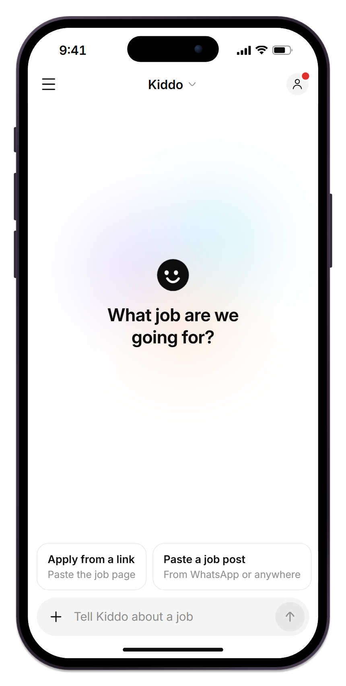
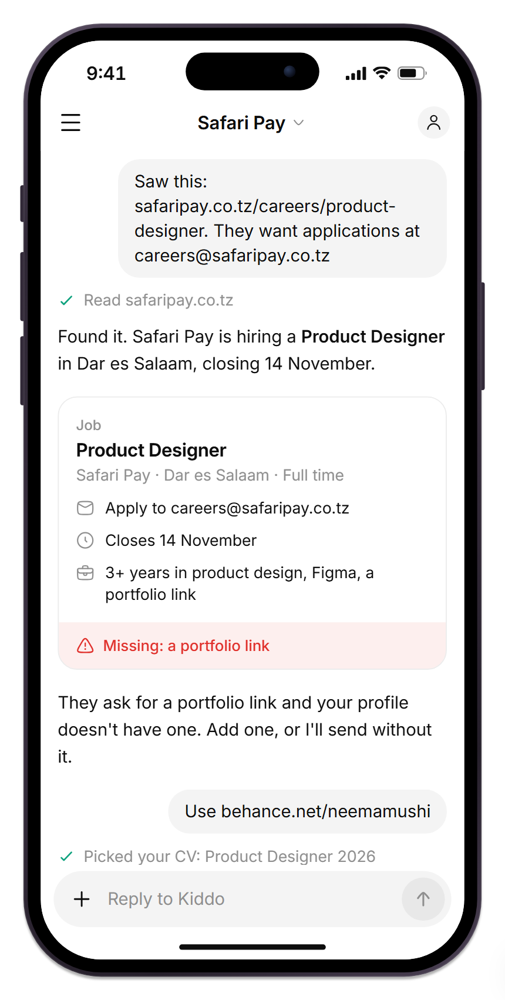
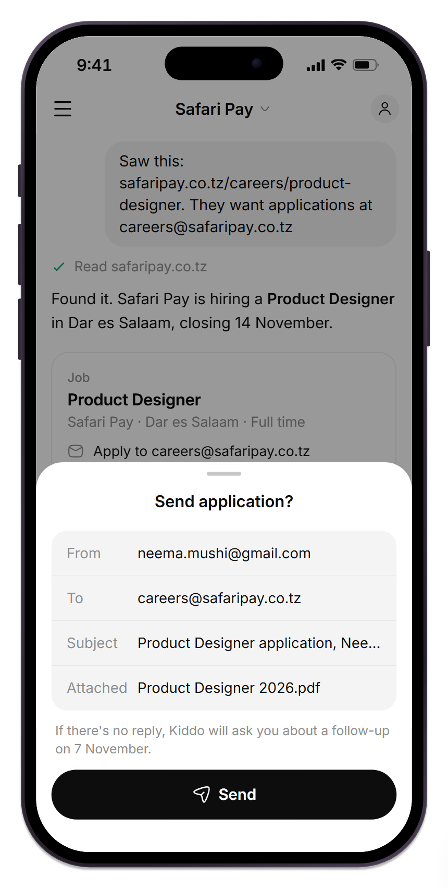
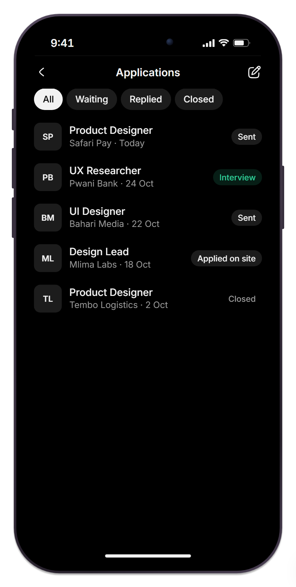
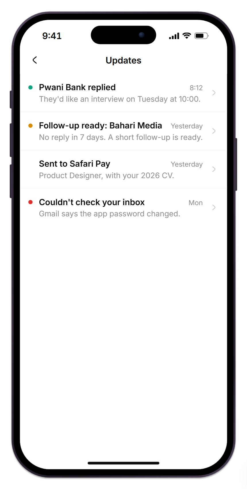
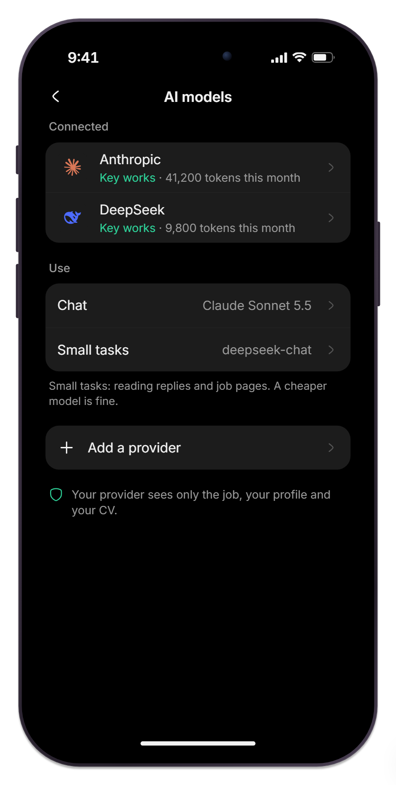

<p align="center">
  
</p>

<p align="center">
  <strong>Apply for jobs from a chat.</strong><br>
  A free, open-source phone app that writes, sends and follows up on your job applications. No server, ever.
</p>

<p align="center">
  
  
  
  
  
  
</p>

---

## Overview

Applying for jobs is the same chore every time: read the post, write a careful email, find the right CV, send it,
then remember to follow up. Kiddo does that with you, from one chat.

Tell Kiddo about a job: paste a link, an email address or the job post. It reads the posting, pulls out the role,
where to apply and what they ask for, then drafts a clean, professional email and picks your best CV. You check it
and tap Send. Kiddo sends it from **your own email**, watches for the reply, and drafts a polite follow-up when it's
quiet.

Everything runs on your phone. There is no Kiddo account, no cloud and no tracking.

## Screens

<table>
  <tr>
    <td align="center"><br><sub><b>Home</b>: tell Kiddo about a job</sub></td>
    <td align="center"><br><sub><b>Apply</b>: Kiddo reads the post</sub></td>
    <td align="center"><br><sub><b>Send</b>: nothing leaves without your tap</sub></td>
  </tr>
  <tr>
    <td align="center"><br><sub><b>Applications</b>: every job and its status</sub></td>
    <td align="center"><br><sub><b>Updates</b>: replies and follow-ups</sub></td>
    <td align="center"><br><sub><b>AI models</b>: bring your own key</sub></td>
  </tr>
</table>

## Features

| | |
| --- | --- |
| **Chat** | Paste a link or a job post. Kiddo reads it, shows what it found and what's missing, then drafts the email. |
| **You approve every send** | Nothing leaves without your tap on a sheet that shows exactly who it goes to, from which account, with which CV. |
| **Applications** | Every job you applied to, its status (Sent, Replied, Interview, Closed) and the email thread. |
| **Follow-ups** | No reply after a week? Kiddo writes a short follow-up and asks you. It stops once they answer. |
| **CVs** | Import a PDF or Word file. "Improve with Kiddo" rebuilds a messy CV into a clean one-page PDF, same facts, nothing invented. |
| **Kiddo browser** | Sites that block reading open in Kiddo's own browser, and Kiddo reads what you see. Or just paste the description. |
| **Updates** | Replies, due follow-ups and problems in one place. |

## Bring your own

**Email.** Gmail with an app password (Kiddo walks you through 2-Step Verification), your own domain over SMTP and
IMAP, or Sendly with a verified domain. Sign in with Google comes once Google approves the app.

**AI.** Use a key from any provider: Anthropic, OpenAI, Google Gemini, DeepSeek, Mistral, xAI, Groq, OpenRouter,
Ollama on your own computer, or any OpenAI-compatible URL. You pay your provider directly. Kiddo adds nothing and uses
no vendor SDK.

## Privacy and security

Kiddo holds the keys to your email and your AI account, so security is the design, not a setting:

- **No server.** Kiddo talks only to the services you connect and the job pages you name.
- **Keys sealed in hardware.** API keys and passwords are encrypted by your phone's secure chip (Android Keystore and
  StrongBox, the iOS Secure Enclave).
- **Encrypted at rest.** Chats, applications and CVs live in an encrypted database on the phone.
- **App lock.** Fingerprint, face or phone PIN.
- **Safe from tricks.** Job pages and emails are treated as text, never instructions. An address that came from a
  page, not from you, is flagged before sending.
- **Your provider sees only what it needs:** the job, your profile and your CV. Never your keys or your inbox.
- **No telemetry.** No analytics, no crash SDK. Backups are an encrypted file you keep.

## Tech stack

| Area | Choice |
| --- | --- |
| App | Kotlin Multiplatform with Compose Multiplatform: one UI for Android and iOS, Android first |
| Architecture | Feature modules, offline-first; every outside service behind an interface |
| Navigation | Navigation Compose (multiplatform), type-safe routes |
| State | AndroidX ViewModel with `StateFlow` |
| Dependency injection | Koin |
| Network | Ktor client with server-sent events for streaming answers |
| Local data | SQLDelight on SQLCipher (Android), and every personal value and file also sealed with a hardware-held key (AES-GCM) |
| Secrets | Android Keystore (StrongBox when present); iOS Keychain with keys wrapped by the Secure Enclave |
| Background | WorkManager on Android; app refresh and scheduled local notifications on iOS |
| Backups | Argon2id (libsodium) passphrase keys and AES-256-GCM, one file format on both phones |
| Web pages | Ksoup turns job pages into readable text |
| Quality | Detekt with Compose rules, ktlint through Spotless |
| Tests | kotlin.test, Turbine, Compose UI tests, Roborazzi screenshot tests |

## Project status

The Android app is built through step 7 and backup. The iOS app shares the same code inside a thin SwiftUI shell and
is ready for its first run on a Mac.

1. App lock, secure storage, encrypted database, settings
2. AI providers and the chat
3. CVs and your profile
4. Email: Gmail, your own domain, Sendly
5. The full apply loop and Applications
6. Follow-ups and Updates
7. The CV builder
8. Backup, Google sign-in, iOS, and release on Google Play, F-Droid and the App Store

## Repository layout

```
app/              Android and iOS app (Kotlin Multiplatform + Compose Multiplatform)
  shared/         The app above the features, started by both platforms (iOS framework KiddoKit)
  androidApp/     The Android app
  iosApp/         The SwiftUI shell, its XcodeGen project and setup-mac.sh
brand/            Brand assets and the script that renders them
.github/assets/   README images
```

## Build

- Android: `cd app && ./gradlew :androidApp:assembleDebug` (JDK 17, Android SDK).
- iOS, on a Mac with Xcode: `app/iosApp/setup-mac.sh` installs the tools, builds the Kotlin framework, generates the
  Xcode project and runs Kiddo in a simulator.

## Contributing

Contributions are welcome once the first app code lands. Open an issue first for anything larger than a small fix.
In short:

- Keep changes focused. Ask in an issue when something is unclear.
- Secrets go only through the secure storage module. Nothing sends without the user's tap.
- Black and white first; colour only signals (green done, red missing, amber waiting).
- Commits are small (at most 100 inserted lines) with short, scoped messages, for example `feat(app): add send sheet`.

Found a security problem? Please report it privately rather than in a public issue.

## Licence

Apache-2.0. Made to share by [isonlycoolie](https://github.com/isonlycoolie).

Inter is by Rasmus Andersson (SIL Open Font License 1.1). AI provider marks are from LobeHub Icons (MIT) and belong to
their owners.
